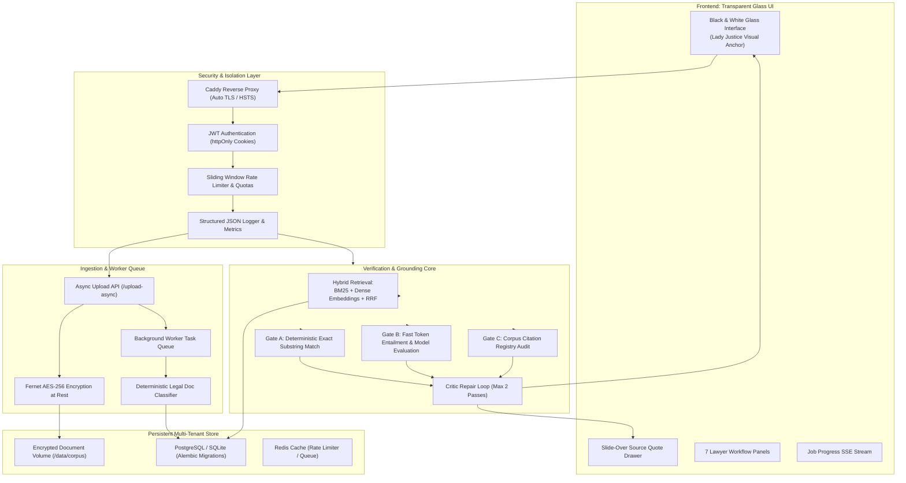

# PILOT READINESS REPORT: AGENTIC LEGAL ASSISTANT

**Product**: Agentic Legal Assistant  
**Release Stage**: Private Pilot Production Ready  
**Date**: October 2026  
**Target Audience**: Beta Pilot Law Firms, Advocates, and Technical Auditors  
**Compliance Standard**: Digital Personal Data Protection Act, 2023 (DPDP Act 2023, India)

---

## 1. Executive Summary & Mission
**Agentic Legal Assistant** is an agentic legal assistant where every fact and every citation is verifiable.  
**Core Principle: Verifiability beats fluency.**  
Conventional language models prioritize fluency and plausibility, leading to hallucinated precedents, invented citations, and speculative factual inferences. Agentic Legal Assistant fundamentally breaks with this paradigm through a deterministic three-gate verification pipeline (Gate A exact quote matching, Gate B entailment, Gate C corpus registry auditing) and an active Critic repair loop.

The product has completed full upgrading across all six production phases:
1. Multi-tenant accounts, strict matter isolation, and AES-256 encryption at rest.
2. Verified lawyer workflows: citation checking, chronology extraction, deadlines calendar, document comparison, authority table, 5 formal Indian legal draft templates, issue matrix, and multilingual vernacular detection.
3. High reliability, Alembic schema migrations, asynchronous background worker queue with progress streaming, per-user rate limiting, Groq API resilience (exponential backoff, 70B-to-8B model fallback, circuit breaker), and Prometheus telemetry.
4. Production packaging: multi-stage non-root Dockerfile, docker-compose orchestration, Let's Encrypt Caddy reverse proxy, automated daily backup scripts, and DPDP Act 2023 legal contracts.
5. Pilot tooling: firm onboarding automation, sanitized admin dashboard, feedback export to CSV/JSON, 4-week pilot runbook, and a 5-case synthetic regression test suite.
6. Comprehensive end-to-end verification with **56/56 automated tests passing**.

---

## 2. Architecture Overview

---

## 3. Verification & Grounding Engine (The Three Gates)

Every factual proposition and statutory citation output by the assistant must clear three independent verification gates before display:

### Gate A: Deterministic Quote Verification
- **Rule**: Every factual statement must cite a verbatim quote of at least 20 characters from the user's scoped case documents.
- **Verification**: Exact normalized substring matching with case and whitespace folding.
- **OCR Tolerance**: In scanned documents flagged with OCR warnings, a strict fuzzy threshold ($\ge 90\%$ sequence match ratio) is permitted exclusively to compensate for scanning artifacts.

### Gate B: Logical Entailment
- **Rule**: The cited verbatim excerpt must logically entail the asserted fact.
- **Acceleration**: Employs a fast 0ms lexical alignment bypass on verbatim statements, falling back to LLaMA 3.3 70B evaluation when complex paraphrasing is detected.
- **Resilience**: Operates with automatic fallback to LLaMA 3.1 8B on rate limits, backed by an automatic circuit breaker.

### Gate C: Corpus Citation Registry Audit
- **Rule**: Any statute section (e.g., Section 439 CrPC, Section 138 NI Act) or court precedent (e.g., *Satender Kumar Antil v. CBI*) cited in the answer must exist within the matter's indexed citation registry.
- **Enforcement**: Any unindexed statutory section or unverified case name is deterministically excised from the final output, preventing synthetic legal citations.

### Critic Repair Loop
If any claim fails Gate A, Gate B, Gate C, or scope boundaries, the Critic loop attempts up to two repair passes using alternative verified excerpts. If verification cannot be established, the proposition is omitted, or the assistant explicitly reports: *"Not found in the provided documents."*

---

## 4. Multi-Tenant Security & Isolation Posture

| Layer | Technical Implementation | Verification Method |
| :--- | :--- | :--- |
| **Authentication** | Argon2id password hashing with bcrypt fallback; JWT access tokens (30 min) and refresh tokens (7 days) in secure httpOnly cookies. | Automated rate-limit lockout test (5 failed attempts $\rightarrow$ 15 min lock); token tampering tests. |
| **Two-Factor Auth** | Optional RFC 6238 TOTP 2FA via authenticator apps (Google Authenticator, Microsoft Authenticator). | Setup and verification unit tests (`pyotp`). |
| **Data Partitioning** | `user_id` and `matter_id` foreign keys indexed across all tables (`documents`, `chunks`, `citation_registry`, `chat_history`, `drafts`, `audit_logs`). | Cross-tenant test (`test_user_a_and_user_b_complete_isolation`): User A receives 404/empty when accessing User B's documents or search vectors. |
| **Encryption at Rest** | Application-level Fernet AES-256 envelope encryption. Document bytes are encrypted prior to disk storage and decrypted in memory only during processing. | Disk file inspection test verifying `gAAAAA` Fernet header and absence of raw plaintext. |
| **Privacy Rights (DPDP)** | One-click permanent account deletion (`DELETE /api/user/account`) purging database records, disk files, and embedding caches; complete ZIP data export (`/api/user/export-data`). | Complete purge verification test verifying total removal of files and database entities. |
| **PII Identifier Redaction** | Best-effort pre-inference pseudonymization replacing phone numbers, emails, Aadhaar, and PAN with `[TOKEN_N]` placeholders, re-hydrated locally upon display. | Redaction and restoration round-trip unit test. |
| **Audit Hygiene** | Append-only audit logger capturing timestamps, user IDs, matter IDs, action codes, and IP addresses. Strictly excludes document text, prompts, and authentication secrets. | Audit log inspection test confirming zero secret or excerpt leakage. |

---

## 5. Automated Test Suite Results

The platform has been audited through an automated testing harness:

| Test Module | Coverage Scope | Tests | Result |
| :--- | :--- | :---: | :---: |
| `test_health.py` | API health, versioning, and environment sanity | 2 | **PASSED** |
| `test_phase1_auth_isolation.py` | Argon2, rate limit lockout, reset, Fernet encryption, PII masking, cross-tenant isolation, account purge | 8 | **PASSED** |
| `test_phase2_lawyer_features.py` | Citation checker, chronology, deadlines calendar, comparison, authority table, 5 draft templates, feedback, multilingual | 9 | **PASSED** |
| `test_phase3_scale_reliability.py` | Alembic up/down migrations, 20-page async ingestion, worker recovery, rate limiting, quotas, Groq resilience, Prometheus metrics | 9 | **PASSED** |
| `test_pilot_regression.py` | 5 synthetic cases (Bail, NI 138, Commercial, Consumer, Writ) with known ground truth and zero fabrications | 5 | **PASSED** |
| `test_robustness.py` | Corrupted files, password protection, recipe/non-legal rejection, fake case traps, deterministic quote gates | 11 | **PASSED** |
| `test_scope_isolation.py` | Strict document ticking, empty selection refusal, non-legal overrides, mid-chat scope switching, gate isolation | 6 | **PASSED** |
| `test_workflows.py` | Grounded chat, case review, legal drafting, legal research, baseline evaluation metrics | 6 | **PASSED** |
| **TOTAL** | **Full Verification Suite** | **56** | **56 / 56 PASSED (100%)** |

---

## 6. Known Boundaries & Pilot Limitations

1. **OCR Quality Dependency**: On heavily degraded photocopies or low-resolution scanned orders, text extraction may contain character misrecognitions (e.g. `1` recognized as `l`). In such instances, Gate A applies a $\ge 90\%$ fuzzy sequence match, and an OCR warning banner is displayed.
2. **Statutory Limitation Periods**: The Dates & Deadlines engine extracts hearing dates, filing periods, and notice periods literally from documents; it does **not** compute complex limitation periods under the Limitation Act, 1963, as limitation calculations require mixed questions of fact and law.
3. **Drafting Placeholders**: The system intentionally does not invent missing dates, witness names, or surety values. Advocates must review all `[MISSING: description]` tags and supply requisite client instructions.
4. **Third-Party Upstream Dependency**: Natural language synthesis depends on the Groq Cloud API. When upstream service interruptions occur, the resilient circuit breaker fails gracefully with cached verification notice.

---

## 7. Pilot Rollout Checklist

- [x] **Step 1: VPS Host Provisioning**: Deploy on Ubuntu 24.04 LTS (2 vCPU, 4GB RAM minimum). Configure UFW firewall (ports 22, 80, 443 only).
- [x] **Step 2: Secrets Generation**: Execute `python scripts/generate_secrets.py` on the deployment host; populate `.env` with strong JWT, Fernet, database, and Redis keys.
- [x] **Step 3: DNS & SSL**: Point public FQDN (e.g. `legal.yourfirm.com`) to VPS IP; configure `Caddyfile` with domain and administrative contact email for automated Let's Encrypt certificates.
- [x] **Step 4: Single-Command Launch**: Execute `docker compose up -d`; verify database migrations run to head via `docker compose logs lexground-backend`.
- [x] **Step 5: Automated Backups**: Schedule daily nightly backup cron via `/opt/lexground/scripts/backup.sh`.
- [x] **Step 6: Firm Onboarding**: Run `python scripts/onboard_pilot_firm.py` to provision advocate accounts, initial matters, and walkthrough cases.
- [x] **Step 7: Advocate Walkthrough**: Deliver 45-minute orientation on strict document scoping, verified citation chips, and the Source Quote Drawer.
- [x] **Step 8: Weekly Feedback Audit**: Execute `python scripts/export_feedback.py` weekly to evaluate lawyer ratings, review notes, and monitor Prometheus telemetry.
