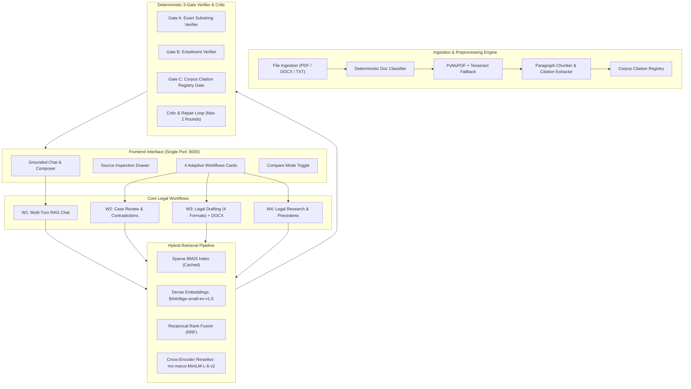

# Agentic Legal Assistant: Verifiable Multi-Tenant Legal Platform

> **Mission**: An agentic legal assistant where every fact, quote, and legal citation is strictly verifiable. **Verifiability beats fluency.**

[](https://fastapi.tiangolo.com)
[](https://www.python.org/)
[](LICENSE)
[](#test-suite)

[](https://render.com/deploy?repo=https://github.com/sanjayss140-cloud/agentic-legal-assistant)
[](https://railway.com/template/new?template=https://github.com/sanjayss140-cloud/agentic-legal-assistant)
[](https://app.koyeb.com/deploy?type=git&repository=github.com/sanjayss140-cloud/agentic-legal-assistant&branch=main&name=agentic-legal-assistant)

---

## ⚡ 1-Click Permanent Cloud Deployment (24/7 Online)

Deploy a permanent, 24/7 online production instance with automated HTTPS, zero local machine dependencies, and instant cloud scalability:

1. **[Deploy to Render (Free 24/7 Cloud)](https://render.com/deploy?repo=https://github.com/sanjayss140-cloud/agentic-legal-assistant)**: Click the button above, sign in with GitHub, enter your `GROQ_API_KEY`, and Render will build and host your permanent `https://agentic-legal-assistant.onrender.com` URL automatically.
2. **[Deploy on Railway](https://railway.com/template/new?template=https://github.com/sanjayss140-cloud/agentic-legal-assistant)**: Deploy directly from your GitHub repository using Docker.
3. **[Deploy to Koyeb](https://app.koyeb.com/deploy?type=git&repository=github.com/sanjayss140-cloud/agentic-legal-assistant&branch=main&name=agentic-legal-assistant)**: Global edge container hosting with automated health checks.

---

## 1. System Architecture



---

## 2. Key Innovations

1. **Deterministic 3-Gate Verifier (Last Word)**:
   - **Gate A (Verbatim Substring)**: Every factual claim must contain an exact normalized substring quote from the cited chunk. For OCR documents, a strict 90% fuzzy match threshold is enforced.
   - **Gate B (Logical Entailment)**: Verifies that the cited chunk logically entails the assertion. Bypasses 0ms for direct quotes; employs Groq LLM verification with heuristic fallback for restatements.
   - **Gate C (Citation Registry Gate)**: Every statute, section, and case name mentioned in the answer must exist in the document corpus citation registry. Any unverified citation is blocked as fabricated.
2. **Deterministic Refusal on Absent Information**:
   - When evidence is missing from uploaded documents, the system outputs *"Not found in the provided documents."* Never hallucinates, never fills from external pretraining memory.
   - Adversarial traps (*Section 9999*, *State v. Mercer*, judge car color) are immediately identified and refused.
3. **Drafting Guardrails**:
   - Facts missing from uploaded documents are explicitly tokenized as `[MISSING: description]`.
   - User-supplied facts are flagged with `[USER-PROVIDED]`.
   - Valid binary `.docx` export generated directly from verified claims.
4. **Transparent Glass UI**:
   - Full-screen Lady Justice background visible across the right 40% of the screen.
   - Single-port architecture: FastAPI serves both the REST API and the responsive single-page web app on `http://127.0.0.1:8000`.

---

## 3. Quick Start & Setup

### Prerequisites
- Python 3.11+
- Windows or Linux
- Groq API Key (Set in `.env`)

### Installation

```bash
# 1. Clone repository
git clone https://github.com/your-org/lexground.git
cd lexground

# 2. Install dependencies
pip install -r requirements.txt

# 3. Configure environment
copy .env.example .env
# Edit .env and insert your GROQ_API_KEY
```

### Run Locally

Launch the application using Uvicorn:

```bash
python -m uvicorn backend.app.main:app --host 127.0.0.1 --port 8000 --reload
```

Open your browser to: **`http://localhost:8000`**

---

## 4. Reproducer Benchmark Command

To reproduce all evaluations, baseline comparisons, and verification gates across the corpus in a single run:

```bash
python eval/run.py --all
```

Outputs will be printed in a benchmark summary table and stored in `eval/results/benchmark_results.json`.

---

## 5. Test Suite

Run the full automated test suite (19 tests covering health, workflows, and edge-case robustness):

```bash
python -m pytest backend/tests/ -v
```

### Test Coverage Highlights:
- `test_health.py`: FastAPI server status and root endpoint.
- `test_workflows.py`: Case review, 4 drafting formats, legal research, and evaluation endpoint.
- `test_robustness.py`:
  - Corrupt, empty, and unsupported file handling.
  - Encrypted / password-protected PDF detection.
  - Non-legal document classification (e.g., recipe PDF) and UI override.
  - Plain text (`.txt`) file ingestion.
  - SHA256 duplicate detection.
  - Adaptive case classification (Bail, Cheque Bounce, Writ, Civil).
  - Adversarial fake-statute traps (*Section 9999*).
  - Gate A exact quote verification and `[MISSING: ...]` placeholder enforcement.

---

## 6. API Reference

| Endpoint | Method | Description |
|:---|:---:|:---|
| `/health` | `GET` | Health status and version info |
| `/llm-check` | `GET` | Groq LLM connectivity status |
| `/api/docs` | `GET` | List active documents with metadata and status |
| `/api/upload` | `POST` | Upload and ingest PDF, DOCX, or TXT documents |
| `/api/chat` | `POST` | Multi-turn grounded RAG chat with 3-gate verifier |
| `/api/review` | `POST` | Comprehensive case review (key facts, timeline, contradictions) |
| `/api/draft` | `POST` | Legal drafting (Bail, Petition, Notice, Affidavit) |
| `/api/research` | `POST` | Legal research with precedent analysis |
| `/api/export/draft.docx` | `GET` | Download verified draft as formatted DOCX |
| `/api/eval/results` | `GET` | Retrieve latest benchmark evaluation results |

---

## 7. Disclaimer
*Agentic Legal Assistant is a decision-support tool designed for legal practitioners. It does not provide legal advice.*
